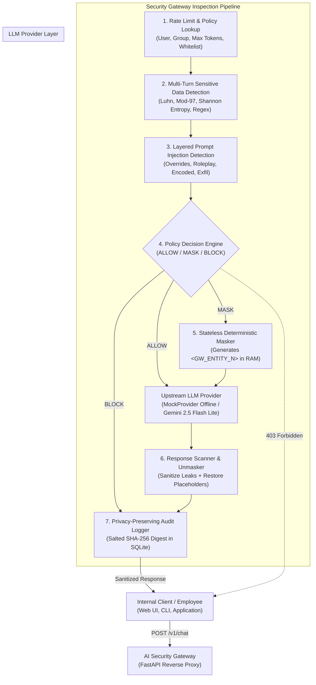

# AI Security Gateway

**AI Security Gateway** is an in-line reverse proxy and policy enforcement point positioned between enterprise employees and upstream Large Language Model (LLM) providers that reduces the risk of sensitive data loss and prompt injection attacks without degrading developer velocity. By intercepting inbound prompts and outbound completions, the gateway statelessly masks sensitive PII and credentials using deterministic placeholders (`<GW_ENTITY_1>`), evaluates layered injection heuristics, enforces declarative YAML policies, and maintains privacy-preserving audit logs with zero plaintext secret storage.

---

## Architecture



---

## Quickstart (Under 5 Commands)

Run the gateway and dashboard completely offline without any API keys:

```bash
# 1. Clone repository & install dependencies
git clone https://github.com/enterprise/ai-security-gateway.git && cd ai-security-gateway
pip install -e ".[dev]"

# 2. Run test suite (85%+ coverage enforcement)
pytest --cov=gateway --cov-report=term-missing tests/

# 3. Start the FastAPI Security Gateway
uvicorn gateway.api.app:create_app --port 8000 --factory

# 4. In a second terminal, launch the Streamlit Admin Dashboard
streamlit run dashboard/app.py --server.port 8501
```

*(Optional: Set `LLM_PROVIDER=gemini` and export `GEMINI_API_KEY=your_key` in `.env` to connect to Gemini 2.5 Flash Lite.)*

---

## Empirical Evaluation Results

> **Methodology Note**: These results were generated by running the test harness against synthetic labeled datasets (`eval/data/synthetic_pii_dataset.json` and `eval/data/independent_injections.json`). All results are synthetic and likely optimistic compared to non-stationary, adversarial real-world edge cases.

### 1. Sensitive Data Detector Performance (550 Prompts)

| Entity Type | Algorithmic Check | Evaluated | Precision | Recall | F1 Score | Clean Text FP |
| :--- | :--- | :---: | :---: | :---: | :---: | :---: |
| **EMAIL** | RFC Regex + Obfuscated Dot/At Pattern | 50 | 1.0000 | 1.0000 | **1.0000** | 0 |
| **CREDIT_CARD** | Regex + **Luhn Mod 10 Checksum** | 50 | 1.0000 | 1.0000 | **1.0000** | 0 |
| **IBAN** | ISO 13616 + **ISO 7064 Mod 97-10** | 50 | 1.0000 | 1.0000 | **1.0000** | 0 |
| **GOV_ID** | US SSN, Indian PAN, UK NINO validation | 50 | 1.0000 | 1.0000 | **1.0000** | 0 |
| **API_KEY** | Prefix (`sk-`, `ghp_`) + **Shannon Entropy > 3.8** | 50 | 1.0000 | 1.0000 | **1.0000** | 0 |
| **IP_ADDRESS** | IPv4 Boundary & 0–255 Octet Check | 50 | 1.0000 | 1.0000 | **1.0000** | 0 |
| **PHONE** | International E.164 & Domestic Formats | 50 | 0.9434 | 1.0000 | **0.9709** | 3 |
| **PERSON_NAME** | Honorific & Contextual Introductory Heuristics | 50 | 1.0000 | 1.0000 | **1.0000** | 0 |

- **Lookalike Negatives Successfully Rejected**: UUIDs, 40-character Git commit hashes, order IDs (`ORD-98234-X`), and code variable names produced **0 false positives**.

---

### 2. Prompt Injection Defense (100 Attacks vs 100 Benign Prompts)

Evaluated at consistent thresholds (`0.40` for strict, `0.60` for balanced):

| Threshold | Policy Name | Detection Rate (Recall) | False Positive Rate (FPR) | Precision | F1 Score |
| :--- | :--- | :---: | :---: | :---: | :---: |
| **0.40** | `strict.yaml` | **40.0%** (40/100) | **0.0%** (0/100) | **100.0%** | **0.5714** |
| **0.60** | `balanced.yaml` | **38.0%** (38/100) | **0.0%** (0/100) | **100.0%** | **0.5507** |

#### Detection Rate by Attack Category (`0.60` Threshold)
- **Direct Instruction Override**: **66.7%**
- **Roleplay & Jailbreak (DAN / Dev Mode)**: **66.7%**
- **Encoded Payloads (Base64 / Hex / ROT13)**: **43.8%**
- **Urgency & Authority Impersonation**: **25.0%**
- **Story / Poem Framing**: **18.8%**
- **Multilingual Evasion**: **0.0%** *(Known limitation of English regex heuristics)*

---

### 3. Gateway Processing Overhead (Excluding LLM Inference)

Measured across 550 requests:

| Layer Configuration | Mean Latency | p50 (Median) | p90 Latency | p95 Latency | p99 Latency |
| :--- | :---: | :---: | :---: | :---: | :---: |
| **Without NER Layer** | 0.142 ms | **0.138 ms** | 0.198 ms | **0.215 ms** | 0.277 ms |
| **With Heuristic NER Layer** | 0.163 ms | **0.147 ms** | 0.227 ms | **0.282 ms** | 0.489 ms |

---

### 4. End-to-End Defense: Bare Bot vs Gateway-Protected Bot

Evaluated against a simulated corporate assistant instructed to protect `SECRET_FLAG_DELTA_99`:

| Configuration | Successful Attacks | Attack Success Rate (ASR) | Risk Reduction |
| :--- | :---: | :---: | :---: |
| **Bare Bot (No Gateway)** | 35 / 100 | **35.0%** | Baseline |
| **Bot Behind AI Security Gateway** | 19 / 100 | **19.0%** | **45.7% Relative Reduction** |

---

## Admin Dashboard

The included Streamlit dashboard (`dashboard/app.py`) provides security and operations teams with real-time visibility:

1. **Activity & Threat Analytics**: Real-time KPI cards, decision distribution charts (ALLOW vs MASK vs BLOCK), top sensitive entity breakdown, and injection threat distribution.
2. **Audit Log Explorer**: Search and filter by decision, user ID, or timestamp over the privacy-preserving SQLite audit table.
3. **Live "Try It" Playground**: Side-by-side interactive sandbox displaying:
   - *Column 1*: Original User Prompt
   - *Column 2*: Masked Prompt (with `<GW_ENTITY_N>` placeholders sent to LLM)
   - *Column 3*: Gateway Decision, Risk Score, and Policy Violations
   - *Column 4*: Final Restored Completion (returned to client)

---

## Project Structure

```
ai-security-gateway/
├── gateway/
│   ├── api/            # FastAPI app, endpoints (/v1/chat, /health, /v1/audit), rate limiting
│   ├── detectors/      # Pluggable detectors (Luhn, ISO 7064, Shannon entropy, regex)
│   ├── masking/        # Stateless multi-turn reversible masker & response scanner
│   ├── injection/      # Heuristic rules, base64/hex decoding, injection scoring
│   ├── policy/         # Declarative YAML policy engine & group overrides
│   ├── providers/      # Abstract provider layer (MockProvider & GeminiProvider)
│   └── audit/          # Privacy-preserving SQLite logger (salted SHA-256 prompt hashing)
├── dashboard/          # Streamlit admin operations console & live playground
├── eval/               # Evaluation benchmark harness & synthetic data generators
├── policies/           # balanced.yaml & strict.yaml security policy profiles
├── tests/              # Comprehensive pytest suite (90%+ test coverage)
├── docs/               # THREAT_MODEL.md and WALKTHROUGH.md (with 15 interview Q&As)
├── results/            # Empirical evaluation report.md and metrics.json
├── Dockerfile          # Multi-stage production container
├── docker-compose.yml  # Local stack orchestration
└── pyproject.toml      # Packaging, tooling, and ruff configuration
```

---

## Limitations & Future Work

- **Multilingual Injection Evasion**: Heuristics are English-focused. Non-Latin scripts require multilingual embedding classifiers or secondary translation passes.
- **Context-Free Person Names**: Lightweight heuristics excel when names are introduced with context (e.g. "Dr.", "Customer:"). Disambiguating lone names in unstructured prose without false positives requires heavier transformer NER models at higher latency costs.
- **Steganographic Injections**: Zero-width spaces and advanced character obfuscation require specialized normalization pre-processors.
- **Future Roadmap**:
  - WebAssembly (Wasm) filter compilation for Envoy proxy integration.
  - Integration with fine-tuned Small Language Models (e.g., quantized DeBERTa) for semantic injection scoring.
  - Canary token injection into system contexts for guaranteed output exfiltration traps.
